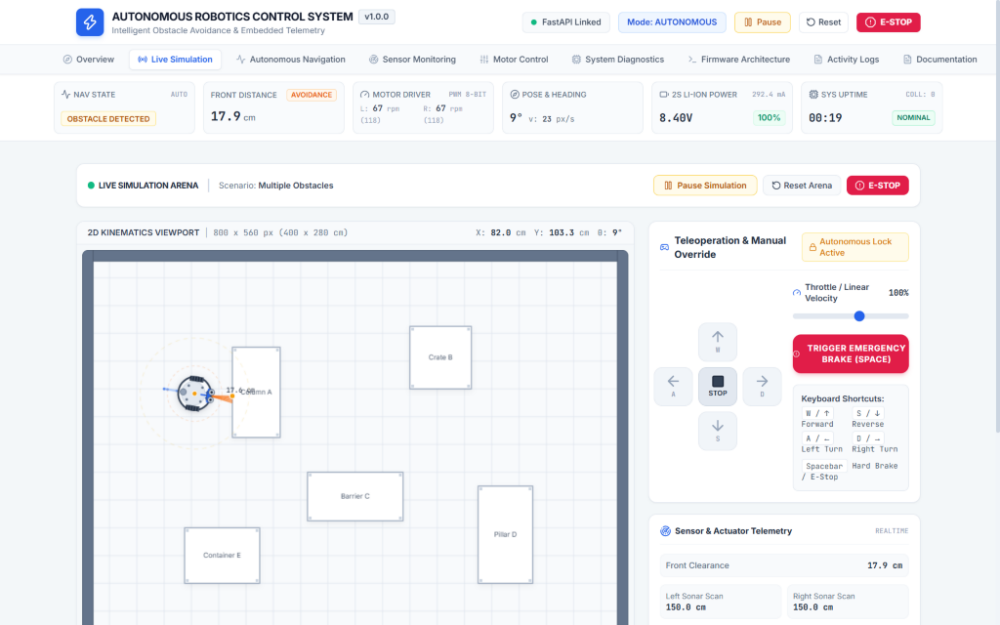
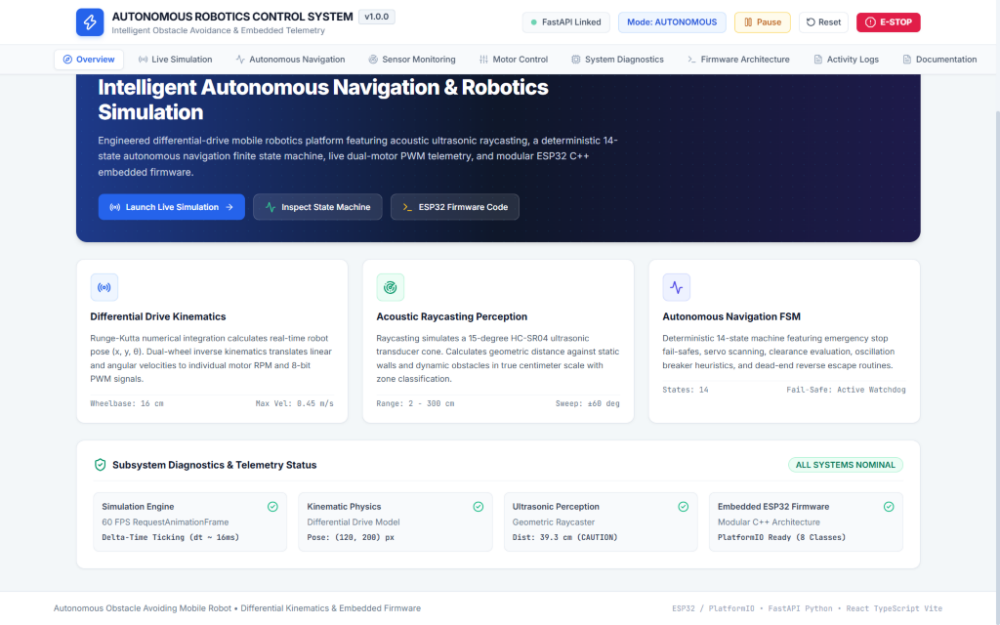
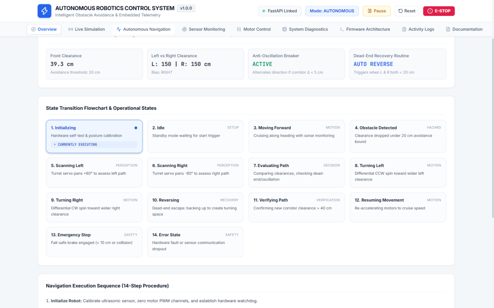
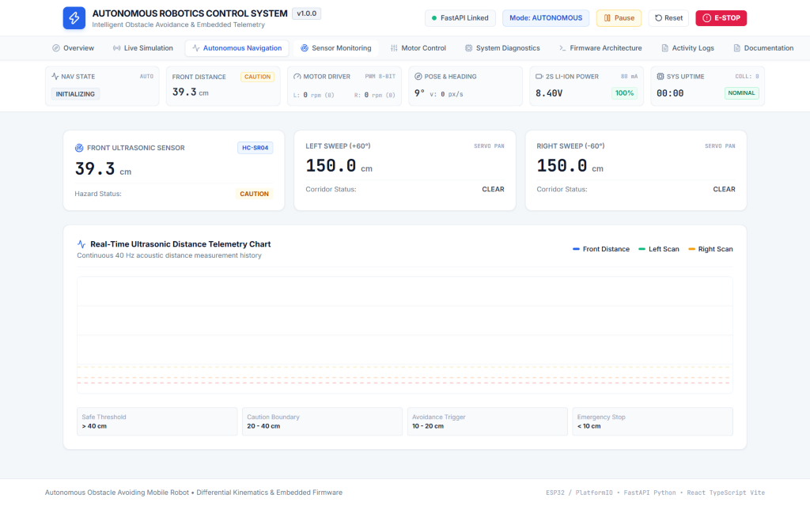
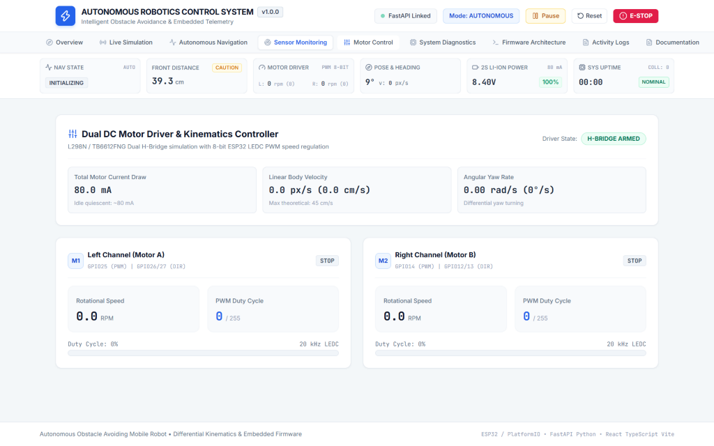

# Autonomous Obstacle Avoiding Robot
INTERN ID:CIS441
> **Intelligent Autonomous Navigation Through Embedded Systems and Robotics Automation.**

[](LICENSE)
[](frontend/)
[](backend/)
[](firmware/)
[-success.svg)](tests/)

---

## 1. Project Overview

The **Autonomous Obstacle Avoiding Robot** is an integrated software-in-the-loop (SIL) robotics engineering platform. It pairs a high-fidelity 2D physics simulation environment with real-time Python telemetry and bare-metal ESP32 C++ firmware. 

Designed as a complete engineering portfolio project, this software models two-wheel differential drive mobile robot kinematics, acoustic raycasting for ultrasonic sensor simulation, a deterministic 14-state autonomous navigation state machine, and dual-motor PWM speed regulation.

---

## 2. Visual Demonstration & Screenshots

### Live Simulation Arena

*Figure 1: Interactive 2D differential-drive kinematics simulation with multi-ray ultrasonic cone, sound wave ripples, and dynamic obstacles.*

### System Overview & Subsystem Readiness

*Figure 2: Architectural overview and real-time subsystem readiness diagnostics.*

### Autonomous Navigation State Machine

*Figure 3: Interactive 14-state reactive navigation state machine inspector with oscillation prevention.*

### Sensor Monitoring & Real-Time Distance Charts

*Figure 4: Acoustic distance telemetry chart with color-coded safety boundaries.*

### Motor Control & H-Bridge Driver Telemetry

*Figure 5: Dual DC motor telemetry showing RPM, 8-bit PWM duty cycles, and current draw.*

---

## 3. Technology Stack

- **Frontend Application**:
  - React 19 + TypeScript + Vite 8
  - Tailwind CSS 3.4
  - Lucide React Icon System
- **Robotics Simulation Engine**:
  - HTML5 Canvas 2D Rendering Engine
  - Runge-Kutta 2nd Order (Midpoint) Numerical Integrator
  - Acoustic Raycasting with 15° Conical Dispersion
  - Axis-Aligned Bounding Box (AABB) Collision Prevention
- **Backend Telemetry Server**:
  - Python 3.12 + FastAPI
  - Uvicorn Asynchronous ASGI Server
  - Bi-directional WebSockets (`/ws/robot`)
  - Pydantic V2 Type Validation
- **Embedded Firmware Architecture**:
  - Embedded C++ (C++14/17 standard)
  - Espressif ESP32 DevKit V1 target
  - PlatformIO + Arduino Framework
  - FreeRTOS Task Watchdog Timer (TWDT)
  - 20 kHz LEDC Hardware PWM Motor Control
- **Automated Verification**:
  - Pytest + Httpx (14 backend tests)
  - Vitest (13 frontend kinematic & raycaster tests)

---

## 4. System Architecture

```
+-------------------------------------------------------------------------+
|                  AUTONOMOUS ROBOTICS CONTROL SYSTEM                     |
|                 (React 19 / TypeScript / Tailwind UI)                   |
+-------------------------------------------------------------------------+
       |                                                   |
       | REST API / WebSocket Stream                       | HTML5 Canvas
       v                                                   v
+-------------------------------+             +---------------------------+
|     Python FastAPI Backend    |             | 2D Kinematics & Acoustic  |
|  - Authoritative 40Hz Physics |             | Raycasting Simulation     |
|  - Bi-directional WebSockets  |             |  - Differential Drive     |
|  - Telemetry & Event Logging  |             |  - 14-State Reactive FSM  |
+-------------------------------+             +---------------------------+
                                                           |
                                           Mirrored State & Firmware Architecture
                                                           v
                                              +---------------------------+
                                              | Embedded ESP32 C++ Core   |
                                              |  - LEDC 20kHz Motor PWM   |
                                              |  - HC-SR04 Median Filter  |
                                              |  - SG90 Servo Turret      |
                                              |  - Hardware Watchdog (WDT)|
                                              +---------------------------+
```

---

## 5. Autonomous Navigation Finite State Machine

The robot implements a deterministic 14-state reactive navigation engine:

1. **`INITIALIZING`**: Hardware self-test, sensor calibration, watchdog initiation.
2. **`IDLE`**: Standby awaiting navigation start trigger.
3. **`MOVING_FORWARD`**: Cruising forward along heading with continuous 40 Hz ultrasonic polling.
4. **`OBSTACLE_DETECTED`**: Front clearance drops below 20 cm avoidance bound; motors brake.
5. **`SCANNING_LEFT`**: Ultrasonic servo turret sweeps to +60° and measures left corridor clearance.
6. **`SCANNING_RIGHT`**: Ultrasonic servo turret sweeps to -60° and measures right corridor clearance.
7. **`EVALUATING_PATH`**: Clearance scoring comparison, anti-oscillation check, dead-end detection.
8. **`TURNING_LEFT`**: Differential CCW spin in place toward safe left opening.
9. **`TURNING_RIGHT`**: Differential CW spin in place toward safe right opening.
10. **`REVERSING`**: Dead-end recovery routine: backing up to create turning clearance.
11. **`VERIFYING_PATH`**: Sensor verifies newly faced corridor clearance is > 40 cm.
12. **`RESUMING_MOVEMENT`**: Smoothly accelerating motors to forward cruise speed.
13. **`EMERGENCY_STOP`**: Fail-safe hard brake triggered when obstacle is < 10 cm.
14. **`ERROR`**: Fail-safe stop upon sensor timeout or watchdog fault.

### Anti-Oscillation & Dead-End Recovery
- **Anti-Oscillation Heuristic**: When corridor clearances differ by less than 5 cm, consecutive turn history alternates bias to prevent infinite limit-cycle ping-ponging.
- **Dead-End Escape**: When both left and right clearances are under 20 cm, the robot executes a timed reverse maneuver before re-evaluating surrounding vectors.

---

## 6. Kinematic Physics & Raycasting Formulations

### Differential Drive Kinematics
Given target linear body speed $v$ and angular yaw rate $\omega$, individual wheel linear velocities $v_L$ and $v_R$ are:
$$v_L = v - \frac{\omega \cdot L}{2}, \quad v_R = v + \frac{\omega \cdot L}{2}$$
Where $L = 0.16\text{ m}$ (16 cm track width) and wheel radius $r = 0.0325\text{ m}$.

Rotational wheel speed is converted to motor shaft RPM:
$$RPM = \frac{v_{\text{wheel}}}{2 \pi r} \times 60$$

### Numerical Pose Integration (Runge-Kutta 2nd Order)
To ensure display refresh-rate independence, robot pose is integrated using delta-time $dt$:
$$\theta_{\text{mid}} = \theta + \omega \cdot dt \cdot 0.5$$
$$x_{\text{new}} = x + v \cdot \cos(\theta_{\text{mid}}) \cdot dt$$
$$y_{\text{new}} = y + v \cdot \sin(\theta_{\text{mid}}) \cdot dt$$
$$\theta_{\text{new}} = (\theta + \omega \cdot dt) \pmod{2\pi}$$

---

## 7. Embedded Firmware & Hardware Wiring

The firmware is located in `firmware/` and compiles with PlatformIO targeting the ESP32 DevKit V1.

### ESP32 Pin Mapping Table

| Subsystem | ESP32 GPIO | Connected Component | Functionality |
| :--- | :--- | :--- | :--- |
| Motor A (Left) | GPIO 25 | L298N ENA | LEDC PWM Speed (20 kHz, Channel 0) |
| Motor A (Left) | GPIO 26 | L298N IN1 | Direction Input 1 |
| Motor A (Left) | GPIO 27 | L298N IN2 | Direction Input 2 |
| Motor B (Right) | GPIO 14 | L298N ENB | LEDC PWM Speed (20 kHz, Channel 1) |
| Motor B (Right) | GPIO 12 | L298N IN3 | Direction Input 3 |
| Motor B (Right) | GPIO 13 | L298N IN4 | Direction Input 4 |
| Ultrasonic | GPIO 5 | HC-SR04 TRIG | 10µs High Output Trigger Pulse |
| Ultrasonic | GPIO 18 | HC-SR04 ECHO | PulseIn Input (via 5V to 3.3V divider) |
| Turret Servo | GPIO 19 | SG90 PWM | 50 Hz Servo Pulse (500µs - 2400µs) |
| Safety & Status | GPIO 2 | Onboard LED | System Heartbeat / Error Blink |
| Safety & Status | GPIO 4 | Active Buzzer | Emergency Stop Acoustic Alarm |

---

## 8. Local Installation & Quick Start

### Prerequisites
- Python 3.10+ (with pip)
- Node.js 18+ (with npm)

### 1. Clone the Repository
```bash
git clone https://github.com/your-username/autonomous-obstacle-avoiding-robot.git
cd autonomous-obstacle-avoiding-robot
```

### 2. Launch the Python Backend
```bash
# In repository root
pip install -r backend/requirements.txt
python -m uvicorn backend.app.main:app --host 127.0.0.1 --port 8000
```
API Docs available at: `http://127.0.0.1:8000/docs`

### 3. Launch the Frontend Application
```bash
# In frontend directory
cd frontend
npm install
npm run dev
```
Open your browser at: `http://127.0.0.1:5173`

---

## 9. Running Automated Tests

### Backend Unit Tests (Pytest)
```bash
# Run 14 backend test cases covering kinematics, raycasting, FSM, and REST APIs
python -m pytest tests/backend -v -o "pythonpath=."
```

### Frontend Unit Tests (Vitest)
```bash
# In frontend directory
cd frontend
npx vitest run
```

---

## 10. Predefined Simulation Scenarios

The simulator includes 6 built-in obstacle configurations:
- **Scenario 1: Open Space** — Baseline forward velocity and boundary testing.
- **Scenario 2: Single Obstacle** — Simple frontal avoidance and turning verification.
- **Scenario 3: Multiple Obstacles** — Complex multi-object obstacle avoidance in cluttered spaces.
- **Scenario 4: Narrow Corridor** — Bounded corridor following with baffle chicane.
- **Scenario 5: Complex Maze** — Multi-wall labyrinth navigation and corner negotiation.
- **Scenario 6: Dead-End Recovery** — U-shaped cul-de-sac testing automated reverse escape routines.

---

## 11. Engineering Scope & Future Work

- **Current Implementation**: Complete software-in-the-loop autonomous mobile robotics platform, 2D kinematic simulator with acoustic raycasting, real-time FastAPI telemetry, and modular C++ firmware for ESP32.
- **Planned Extensions**:
  - ROS 2 Humble integration via micro-ROS for ESP32.
  - Extended Kalman Filter (EKF) fusing wheel odometry with simulated IMU (MPU-6050).
  - 2D LiDAR SLAM (RPLiDAR A1) with occupancy grid mapping.
